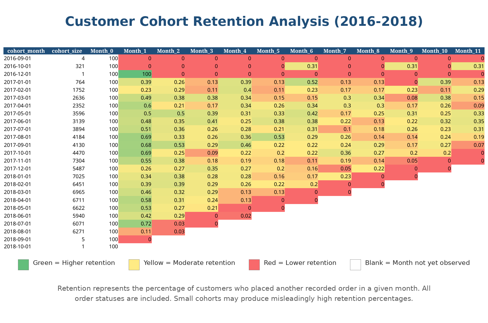

# Cohort Retention Analysis: Do Customers Come Back?


> **Short answer: almost none do.** Only **3.12%** of customers placed more than one recorded order, and average Month 1 cohort retention was just **0.46%**.

This project analyzes customer repeat-purchase behavior using the Olist Brazilian E-Commerce dataset and Microsoft SQL Server. The objective is to understand how customer retention changes across acquisition cohorts and identify opportunities to improve repeat purchases.

---

## Table of Contents

- [Business Question](#business-question)
- [Key Findings](#key-findings)
- [Cohort Retention Heatmap](#cohort-retention-heatmap)
- [Dataset](#dataset)
- [Methodology](#methodology)
- [SQL Analysis](#sql-analysis)
- [Recommendations](#recommendations)
- [Limitations](#limitations)
- [Tools Used](#tools-used)
- [Project Structure](#project-structure)
- [Author](#author)

---

## Business Question

**Do customers acquired in different months retain differently, and how many customers come back after their first purchase?**

Customer retention is an important measure of business performance. Understanding repeat-purchase behavior helps businesses identify retention problems, evaluate customer engagement and develop strategies to encourage repeat purchases.

---

## Key Findings

| Metric | Result |
|---|---:|
| Monthly cohorts analyzed | 25 |
| Analysis period | Sep 2016 – Oct 2018 |
| Unique customers | 96,096 |
| Total recorded orders | 99,441 |
| Largest cohort | November 2017 |
| Largest cohort size | 7,304 |
| Repeat customers (2+ orders) | 2,997 (3.12%) |
| One-time customers | 93,099 (96.88%) |
| Average Month 1 retention | 0.46% |

### What the numbers tell us

- **96.88% of customers placed only one recorded order.** This indicates a substantial repeat-purchase challenge.
- **Month 1 retention averaged just 0.46%.** This is the unweighted average of cohort-level retention percentages across 21 cohorts with at least 100 customers.
- **November 2017 recorded the largest cohort**, with 7,304 customers.
- **Retention varied across cohorts.** Some acquisition months performed better than others, although repeat-purchase rates remained low overall.
- Small cohorts can produce misleading retention percentages and should be interpreted cautiously.

---

## Cohort Retention Heatmap

The heatmap visualizes monthly customer retention across all 25 cohorts.



### How to read the heatmap

- Green: Higher retention
- Yellow: Moderate retention
- Red: Lower retention
- Blank: Month not yet observed

Month 0 represents the initial cohort and therefore has 100% retention. Month 1 represents the first month after acquisition, Month 2 the second month, and so on.

---

## Dataset

- **Dataset:** Olist Brazilian E-Commerce Public Dataset
- **Source:** [Kaggle – Brazilian E-Commerce Public Dataset by Olist](https://www.kaggle.com/datasets/olistbr/brazilian-ecommerce)
- **Analysis period:** September 2016 – October 2018
- **Total order records:** 99,441
- **Unique customers:** 96,096

### Primary tables used

- `olist_customers_dataset`
- `olist_orders_dataset`

### Important customer identifier distinction

The analysis uses `customer_unique_id` as the customer identifier rather than `customer_id`.

The `customer_id` field is associated with individual customer-order records, whereas `customer_unique_id` identifies the same underlying customer across multiple orders. Using the correct identifier is essential for accurate retention analysis.

---

## Methodology

### 1. Data Extraction

Loaded customer and order data from the existing Olist database in Microsoft SQL Server.

### 2. Customer Identification

Joined customer and order tables using `customer_id` and used `customer_unique_id` to identify individual customers.

### 3. Cohort Assignment

Assigned each customer to a cohort based on the month of their first recorded order.

### 4. Monthly Activity Calculation

Calculated the number of months between each customer's first purchase month and subsequent order months.

### 5. Retention Calculation

Calculated monthly retention using:

**Retention Rate = (Active Customers in Cohort Month / Original Cohort Size) × 100**

Each month's retention is calculated independently, not cumulatively.

### 6. Cohort Analysis

Created a cohort retention matrix covering Month 0 through Month 11.

- Month 0 retention is 100%.
- Observed months with no repeat activity are represented as 0%.
- Future unobserved months are represented as NULL.

### 7. Validation

Performed data-quality checks for missing values, unmatched records, duplicate customer mappings, cohort sizes and retention percentages.

### 8. Visualization

Exported the SQL retention matrix to CSV and created the cohort retention heatmap using Microsoft Excel.

---

## SQL Analysis

The project includes three SQL scripts:

| File | Purpose |
|---|---|
| `01_cohort_analysis.sql` | Customer cohort assignment, monthly activity and retention matrix |
| `02_data_validation.sql` | Data-quality and cohort validation |
| `03_cohort_insights.sql` | Cohort rankings, monthly retention performance and repeat-customer analysis |

### Additional Analysis

- Cohort size ranking
- Average monthly retention by cohort age
- Best and worst performing cohorts
- Overall repeat-customer analysis
- Order frequency distribution

---

## Recommendations

Based on the analysis, the following actions could help improve customer retention:

| # | Recommendation | Business Reason |
|---|---|---|
| 1 | Investigate why customers do not return | 96.88% of customers placed only one recorded order |
| 2 | Test post-purchase engagement campaigns | Month 1 retention is approximately 0.46% |
| 3 | Analyze retention by product category | Different product categories may have different repeat-purchase patterns |
| 4 | Evaluate delivery experience and customer reviews | Customer experience may influence repeat purchases |
| 5 | Monitor cohort retention regularly | Helps measure whether retention initiatives are effective |

These are recommendations for further investigation and testing, not proven causes of customer churn.

---

## Limitations

- **All order statuses are included:** The analysis includes delivered, canceled, unavailable and other order statuses. Therefore, it measures recorded order activity rather than strictly completed or delivered purchases.
- **Recent cohorts have less observation time:** Customers acquired near October 2018 have fewer subsequent months available for retention measurement.
- **Small cohorts:** Cohorts with fewer than 100 customers are retained in the full heatmap but excluded from comparative cohort insights.
- **No churn reasons:** The dataset does not directly explain why customers do not return.
- **Monthly retention is not cumulative:** A customer is counted as active in a month only if they placed an order during that specific month.

A delivered-only retention analysis would be a useful next step.

---

## Tools Used

- **Microsoft SQL Server** – Data extraction, transformation and analysis
- **SQL Server Management Studio (SSMS)** – SQL development and execution
- **Microsoft Excel** – Cohort heatmap visualization
- **Git** – Version control
- **GitHub** – Project hosting and documentation

---

## Project Structure

```text
cohort-retention-analysis/
│
├── sql/
│   ├── analysis/
│   ├── validation/
│   ├── 01_cohort_analysis.sql
│   ├── 02_data_validation.sql
│   └── 03_cohort_insights.sql
│
├── exports/
│   ├── cohort-retention-matrix.csv
│   └── cohort-retention-matrix.xlsx
│
├── visuals/
│   └── cohort_retention_heatmap.png
│
├── docs/
│
├── README.md
└── .gitignore
```

---

## Author

**Satyam Katara**

Data Analytics | SQL | Python | Power BI

- GitHub: [satyam-katara](https://github.com/satyam-katara)

---

*This project was developed to explore customer retention, cohort analysis and repeat-purchase behavior using SQL Server and real-world e-commerce data.*